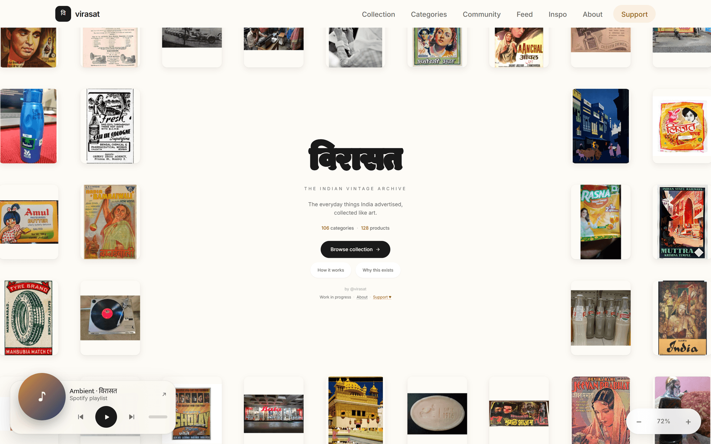

# विरासत · Virasat

**Virasat — an online museum of India's everyday design.**

**Live site:** https://virahst.vercel.app



## Why it exists

Virasat is a passion project, inspired by [ciggies.app](https://ciggies.app). India's old
everyday design — biscuit packets, matchbox labels, hand-painted signs, film posters — is
scattered across old newspapers, family cupboards and forgotten corners of the internet.
Virasat puts it in one place, so it isn't lost.

## Features

- **Infinite canvas** — drag around and zoom through a big wall of old ads, packets and posters.
- **Collection grid** — the same archive as a list you can search, filter and sort.
- **Item pages** — each object with its picture and the story behind its ad.
- **Inspo board** — a moodboard: pick the items you like, arrange them, draw and add notes.

## Work in progress

Virasat is still being built. Some items don't have pictures yet, some text is still
placeholder text, and some details may be wrong. New things are added all the time.

## How to help

- **Suggest an item** or **report a mistake** — [open an issue](https://github.com/SahilMotyar/Virahst/issues/new/choose).
- **Send old photos** — photos or scans of old ads, packets, tins, labels, posters or tickets.
  Email them to me (the address is on the [About page](https://virahst.vercel.app/about#help)),
  and tell me where each one came from.
- **Code changes** — see [CONTRIBUTING.md](CONTRIBUTING.md).

## Run it locally

You need [Node.js](https://nodejs.org) 20.9 or newer.

```bash
git clone https://github.com/SahilMotyar/Virahst.git
cd Virahst
npm install
cp .env.example .env.local   # optional: every value in it can stay empty
npm run dev
```

Then open the address it prints (usually http://localhost:3000).

## How to add an item

1. Add one entry to [`src/data/items.ts`](src/data/items.ts), including its `source` fields
   (where the picture came from, who made it, and its license):

   ```ts
   {
     id: "my-item",
     slug: "my-item",
     name: "मेरी चीज़",           // Devanagari name
     nameEn: "My Item",
     brand: "ब्रांड",
     brandEn: "Brand",
     category: "packaging",
     era: "1960s",
     region: "Bombay",
     image: "/items/my-item.webp",
     favorites: 0,
     comments: 0,
     advertising: { tagline: "…", medium: "print", years: "1960s", body: "The story behind it." },
     source: {
       commonsFile: "File:…",
       url: "https://commons.wikimedia.org/wiki/File:…",
       license: "CC BY-SA 4.0",
       licenseUrl: "https://creativecommons.org/licenses/by-sa/4.0/",
       author: "Who made the picture",
       credit: "\"…\" by …, CC BY-SA 4.0, via Wikimedia Commons",
       taglineIsOriginal: false,
     },
   },
   ```

2. Save the picture as `public/items/<slug>.webp` (WebP, at most 1600px wide).
3. Run `npm run thumbs` to make the small version used on the canvas.
4. Add a line for it to [CREDITS.md](CREDITS.md).

## Pages on the site

- [About](https://virahst.vercel.app/about) — why I made this, and how to help
- [Support](https://virahst.vercel.app/support) — chip in to keep it going
- [Image credits](https://virahst.vercel.app/credits) — also in [CREDITS.md](CREDITS.md)

## For developers

- Site name, copy, contact details and feature flags all live in [`src/config.ts`](src/config.ts).
- The canvas (pan, zoom, momentum, only drawing what's on screen) is hand-written, in
  [`src/components/canvas/`](src/components/canvas/).
- Colours: use `text-accent-ink` for any orange text or icon, never `text-accent`, which is too
  light to read on the cream background.
- Built with Next.js, React, TypeScript, Tailwind CSS, Zustand and Excalidraw.

## License

The **code** is under the [MIT License](LICENSE).

The MIT license covers the code only. **Images keep their own licenses** (public domain, CC0,
CC BY, CC BY-SA and others). See [CREDITS.md](CREDITS.md) and the
[/credits page](https://virahst.vercel.app/credits) for who made each picture and under which license.
